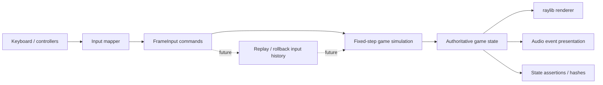
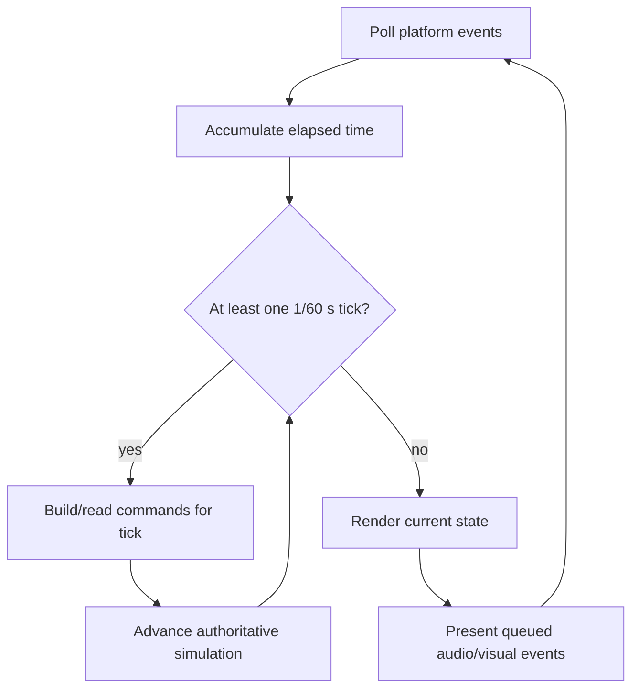
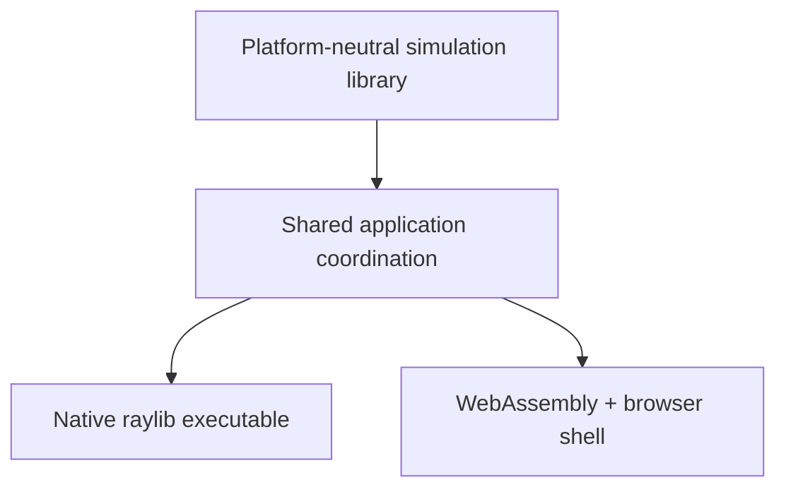

# Architecture

## Status of this document

Sections labeled **Implemented** describe the Phase 1A code. Other sections remain proposed future architecture. The core build, smoke test, native Linux renderer, and browser renderer are verified; Windows and macOS remain untested targets.

## Design goals

- A readable C++17 codebase with narrow module boundaries
- Fixed 60 Hz gameplay independent of rendering rate
- Testable combat logic with no raylib dependency
- Per-frame input commands suitable for recording and later replay
- A native and WebAssembly application using the same gameplay simulation
- A practical path toward rollback networking without prematurely implementing it

## Source ownership

| Path | Responsibility |
| --- | --- |
| `src/core/` | Implemented: platform-neutral initial game state, fixed-step constants, and tick advancement |
| `src/game/` | Match orchestration, fighter state, rounds, stage state |
| `src/combat/` | Moves, hit/hurt collision, damage, hit-stun, knockback, combos |
| `src/input/` | Device sampling, bindings, and conversion to frame commands |
| `src/render/` | Implemented in Phase 1A: raylib render-target ownership, placeholder arena/fighters, HUD, and scaling |
| `assets/` | Character, arena, and audio content loaded by presentation systems |
| `tests/` | Implemented initially: headless initialization and simulation-frame advancement smoke test |
| `scripts/` | Implemented initially: desktop and Emscripten configure/build/run helpers |

`src/main.cpp` is the implemented platform entry point and owns window lifetime, timing accumulation, and native/browser loop scheduling. The `game`, `combat`, and `input` directory responsibilities remain proposed for later phases.

## Proposed runtime data flow

The authoritative state changes only during fixed simulation ticks. Rendering and audio may interpolate or present that state but must not modify combat outcomes.

## Application entry point — Implemented

`src/main.cpp` initializes the raylib window and a small application context containing `Game`, `GameRenderer`, and the timing accumulator. Native builds use a conventional loop. Emscripten builds register `BrowserMainLoop` with `emscripten_set_main_loop_arg`, so browser code does not enter a blocking loop. The browser callback does not call raylib's synchronous `WindowShouldClose()` or target-FPS wait paths; requestAnimationFrame owns scheduling. Both paths call the same `RunFrame` function and keep gameplay rules out of the entry point.

## Game loop — Implemented foundation

Rendering runs at the platform frame rate while an accumulator advances zero or more fixed simulation ticks of `1/60` second. Frame delta is clamped to 250 ms, bounding a single rendered frame to at most 15 catch-up ticks. The only current simulation behavior increments the authoritative frame counter; per-player commands begin in Phase 1B.

The browser loop and rendering are verified in automated Chrome testing. The native loop, rendering, and clean window-manager shutdown are verified in a Linux X11/OpenGL session.

## Input system

**Proposed:** Platform-specific devices map to a compact `FrameInput`-style value containing directional intent and discrete button states. Gameplay sees commands such as held, pressed, and released actions—not raylib keys. Commands should be serializable and comparable so later systems can record, replay, predict, and correct input histories.

Local bindings will initially support two players on one keyboard. Controller support is planned but not part of the first gameplay milestone.

## Fighter state

**Proposed:** Each fighter owns or references composed state for:

- identity and tuning data;
- position, velocity, facing, and grounded state;
- health and special energy;
- current combat state, move, and frame counters;
- hit-stun, block-stun, invulnerability, and recovery;
- active hitbox/hurtbox data;
- round-local combo and hit tracking.

Simulation state must not contain textures, sounds, or other renderer-owned resources. Fighter definitions should carry data such as movement speeds, move timings, damage, and box definitions separately from mutable match state.

## Combat system

**Proposed:** On each fixed tick, combat processing will follow an explicit, tested order. A likely initial order is command interpretation, state transitions, movement integration, box generation, collision queries, hit resolution, resource changes, and state cleanup. The precise ordering will be documented before combat implementation because it affects trades, interrupts, and replay consistency.

Moves will be described by frame data: startup, active, recovery, damage, hit-stun, block-stun, knockback, energy cost/gain, and box definitions. Combat should emit presentation events rather than directly playing sound or drawing effects.

## Collision detection

**Proposed:** Phase 1 uses simple axis-aligned rectangles in world coordinates for stage collision, hurtboxes, and hitboxes. Collision queries remain in the simulation layer and use gameplay-owned geometry types or adapters independent of raylib. Broad-phase optimization is unnecessary for two fighters until profiling demonstrates a need.

Each attack activation needs a stable identifier so one hitbox does not damage the same target repeatedly unless the move explicitly permits multiple hits.

## Renderer and audio

**Renderer implemented:** `GameRenderer` translates read-only `GameState` into raylib draw calls and owns a 1280×720 render texture. It draws the Phase 1A arena, placeholders, and HUD at logical resolution, then scales and letterboxes the result to the actual window. Core state contains no raylib types, and rendering does not mutate it.

**Audio proposed:** No audio resources or presentation layer exist yet. A later audio layer will consume events and own sound/music resources without changing simulation outcomes.

Placeholder primitives should precede final assets. Art dimensions must not silently define gameplay collision geometry.

## Assets

**Proposed:** Assets are grouped by purpose under `assets/characters/`, `assets/arenas/`, and `assets/audio/`. A later asset manifest may map stable logical identifiers to files. Source/license attribution requirements will be recorded alongside imported content. Generated build copies are ignored; authored source assets remain version-controlled.

## Native and WebAssembly builds — Implemented, platform verification pending

CMake defines `arena_clash_core`, `ArenaClash`, and `arena_clash_core_tests`. FetchContent downloads the official raylib 6.2 tag archive and verifies its SHA-256. `ARENA_CLASH_BUILD_APPLICATION=OFF` permits headless core tests without downloading or configuring raylib.

Native builds use `build/desktop`. Browser builds use the Emscripten toolchain in `build/web`, set raylib's `PLATFORM` to `Web`, emit `arena-clash.html`, and use `web/shell.html`. Keeping these directories separate prevents incompatible toolchain caches and raylib artifacts from being shared.

The core target and CTest test have been built on Linux. The Emscripten 6.0.12 output is verified in headless Google Chrome 153 with WebGL and the logical render texture active. The native Linux Release target is verified using raylib's X11 backend and an Intel/Mesa OpenGL 4.6 context. Windows and macOS remain untested targets.

## Future multiplayer integration

**Proposed, not scheduled before Phase 4:** Gameplay commands will be indexed by simulation frame. A rollback layer can later retain recent state snapshots and inputs, predict missing remote commands, then restore and resimulate when confirmed inputs differ. Rendering and audio must tolerate corrected simulation state and avoid duplicating irreversible presentation effects.

Networking will not be embedded in fighter or combat code. Before online play, the project needs deterministic replay tests, state serialization, desync diagnostics, and an explicit session/transport design. Cross-platform bit-for-bit determinism is not assumed.

## Implemented architecture

Phase 1A establishes these validated boundaries:

- `arena_clash_core` contains only standard C++ game state and fixed-tick advancement.
- `GameRenderer` owns raylib resources and observes `const GameState&`.
- `main.cpp` owns platform lifecycle, wall-clock accumulation, and loop registration.
- Native and browser paths share `RunFrame`, `Game`, and rendering code; only scheduling differs.
- Generated dependencies and outputs live under target-specific ignored build directories.
- The initial core state can be recreated with `Game::initialize`; general state serialization/restoration is deferred.

Input commands, combat, match flow, audio, replay storage, deterministic state hashing, and rollback remain proposed. Fixed ticks and clean boundaries are preparation for those systems, not evidence of cross-platform determinism.
