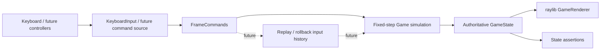
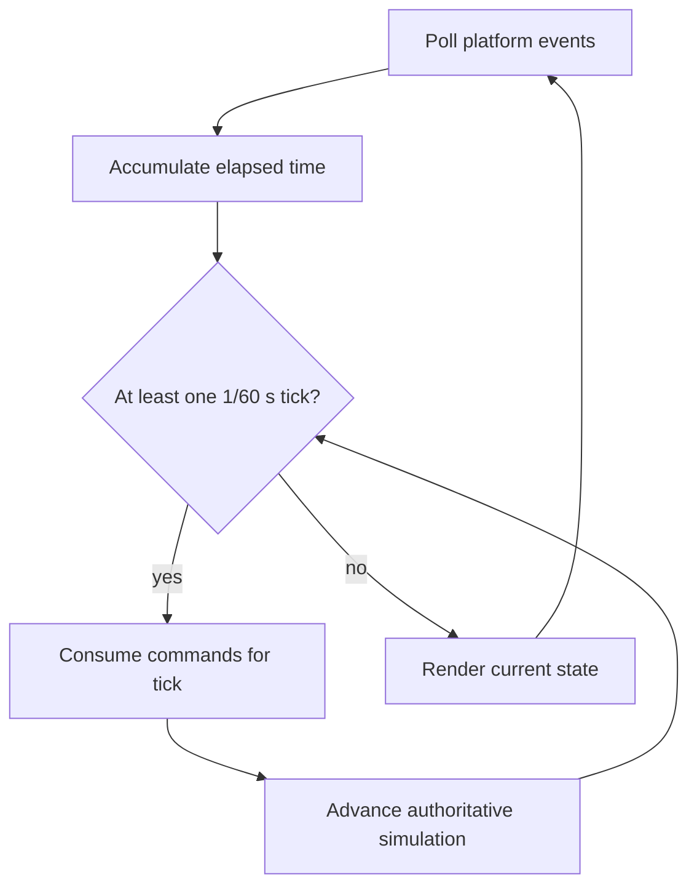
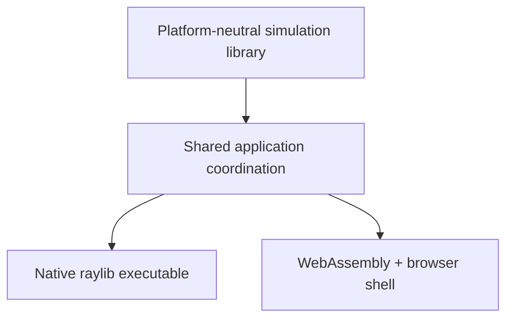

# Architecture

## Status of this document

Sections labeled **Implemented** describe the code through Phase 1D-B. Movement, basic combat, energy, charge-state foundations, and two character-specific specials are verified in core tests; the current application is built for native Linux and WebAssembly and exercised in Chrome. Charged-hit resolution, ultimates, audio, replay storage, round flow, and networking remain proposed; Windows and macOS remain untested targets.

## Design goals

- A readable C++17 codebase with narrow module boundaries
- Fixed 60 Hz gameplay independent of rendering rate
- Testable combat logic with no raylib dependency
- Per-frame input commands suitable for recording and later replay
- A native and WebAssembly application using the same gameplay simulation
- A practical path toward rollback networking without prematurely implementing it

## Source ownership

| Path | Responsibility |
| --- | --- |
| `src/core/` | Implemented: platform-neutral game/projectile state, fixed-tick coordination, movement/physics, body collision, charge transitions, projectile advancement, and simultaneous combat/energy resolution |
| `src/game/` | Implemented: composed fighter identity, tuning, position, velocity, collision, grounding, facing, health/energy, combat/charge state, timers, move-effect bookkeeping, and feedback state; future match/round state belongs here |
| `src/combat/` | Implemented: data-backed normal/special definitions, centralized energy/charge rules and special spending, platform-neutral boxes, overlap queries, and guard queries |
| `src/input/` | Implemented: platform-neutral per-fighter commands and render-to-tick edge buffer plus raylib keyboard sampling |
| `src/render/` | Implemented: raylib render-target ownership, state-driven arena/fighters/combat/charge/special effects, projectile presentation, health/energy HUD, KO feedback, debug boxes, and scaling |
| `assets/` | Character, arena, and audio content loaded by presentation systems |
| `tests/` | Implemented: raylib-free movement, combat/special timing, projectile lifecycle, hit/block/miss/trade/KO, boundary, input, and same-build replay regressions |
| `scripts/` | Implemented: desktop and Emscripten configure/build/run helpers |

`src/main.cpp` owns window lifetime, timing accumulation, input sampling coordination, the presentation-only debug-box toggle, and native/browser loop scheduling. Gameplay decisions remain inside the shared core.

## Runtime data flow — Implemented core path

The authoritative state changes only during fixed simulation ticks. Rendering observes state but cannot modify combat outcomes. A future audio layer should consume presentation events rather than enter the simulation dependency path.

## Application entry point — Implemented

`src/main.cpp` initializes the raylib window and a small application context containing `Game`, `KeyboardInput`, `GameRenderer`, the timing accumulator, and debug-draw state. Native builds use a conventional loop. Emscripten builds register `BrowserMainLoop` with `emscripten_set_main_loop_arg`, so browser code does not enter a blocking loop. The browser callback does not call raylib's synchronous `WindowShouldClose()` or target-FPS wait paths; requestAnimationFrame owns scheduling. Both platforms call the same `RunFrame` function.

## Game loop — Implemented

Rendering runs at the platform frame rate while an accumulator advances zero or more fixed simulation ticks of `1/60` second. Frame delta is clamped to 250 ms, bounding a single rendered frame to at most 15 catch-up ticks. Input is sampled once per rendered frame. `FrameCommandBuffer` keeps the latest held values available to every catch-up tick, OR-accumulates press/release edges across render frames with no tick, and clears those edges after exactly one simulation-tick consumption.

The browser loop and combat rendering are verified in automated Chrome testing. The native loop, combat rendering, and normal Escape shutdown are verified in a Linux X11/OpenGL session.

## Input system — Implemented

`FrameCommands` contains one `FighterCommand` per player. Each command records held movement/jump/block/attack values, just-pressed jump/light/heavy events, and held/pressed/released special and charged-attack values. `KeyboardInput` is the only gameplay-input component that queries raylib: it maps VOLT to `A`/`D`/`W`/`S`/`F`/`G`/`H`/`J` and EMBER to Left/Right/Up/Down/`K`/`L`/semicolon/apostrophe, then passes plain sampled values to `FrameCommandBuffer`.

Normal attack held values document current device state but do not start moves; only a new buffered press can do so. Charge starts from a press, advances from held state, and resolves from a release edge or observed not-held state. A buffered special press selects the fighter's configured special and attempts an atomic activation/spend. `Game` never queries devices, so tests and future replay, AI, or network sources can provide the same commands directly.

raylib 6.2's Emscripten backend maps physical DOM `Semicolon` and `Quote` codes to `KEY_SEMICOLON` and `KEY_APOSTROPHE` and registers key-down/key-up callbacks on the canvas. Chrome runtime input verified both special controls, including the `Semicolon` DOM code; physical keyboard ghosting, rollover, and non-US punctuation layouts remain device-dependent and unverified.

## Fighter state — Implemented

Each `Fighter` composes:

- identity, movement speed, jump velocity, and collision dimensions;
- platform-neutral position and velocity values;
- grounded state and facing direction;
- mutable current/maximum health and energy;
- available, attacking, blocking, charging, hit-stun, or KO state;
- current move/phase and frame count, stun duration, per-activation connection/effect flags, charge duration/release outcome, and short hit/block/special-impact feedback counters.

`GameState` also owns a fixed eight-slot array of projectile values. An active projectile stores its owner, source move, position/velocity, captured direction, remaining lifetime, and current hitbox. Simulation state contains no textures, sounds, raylib vectors, heap-owned projectile entities, or other presentation resources. Charged damage/hitboxes, ultimates, combos, and match/round state are not implemented.

## Combat system — Implemented through Phase 1D-B

`MoveDefinition` stores a stable move identifier, owning fighter, melee/projectile behavior, energy cost, damage, startup/active/recovery frame counts, hitbox dimensions/offsets, hit-stun, knockback, projectile speed, and projectile lifetime. Shared definitions provide light (6 damage, 5/3/10 frames), heavy (14 damage, 12/4/17), VOLT's Thunder Bolt (16 damage, 12/1/20, 650 units/second, 90-tick lifetime), and EMBER's Inferno Burst (20 damage, 16/5/24). `CombatRules` centralizes the 100 energy cap, normal hit/block awards, 25 special cost, and 18/72 charge thresholds. Block-stun, multi-hit, actual charged-move, and cancel data remain absent.

The press tick is startup frame 1. A phase is processed for exactly its configured number of ticks; the next phase begins at the start of the following tick. After the last recovery tick, the fighter becomes available at the start of the next tick and may accept a command then. A new hit sets hit-stun frame progress to zero after impact, so the configured number of restricted stun ticks begins on the following tick.

The implemented per-tick order is:

1. Decay feedback; complete elapsed attack/stun phases; validate block, normal, special, and charge transitions, including atomic special spending.
2. Apply permitted movement input, integrate horizontal movement and gravity, and constrain the stage.
3. Resolve symmetric movement-body collision using prior left/right order.
4. Update facing from final positions.
5. Advance existing projectiles, then create a projectile once for each newly active projectile move.
6. Generate melee hitboxes and snapshot both fighter and projectile overlaps, guard outcomes, origins, and move references without damage mutation.
7. Mark every valid melee activation as connected or projectile as inactive, then advance existing attack/stun frame counters.
8. Resolve the snapshotted energy awards, blocks or damage, charge/special interruption, hit-stun, knockback, health clamp, and KO outcomes.
9. Decrement projectile lifetime/remove expired or out-of-bounds projectiles, then increment the simulation frame.

Because step 6 snapshots all candidates before step 8 changes either fighter, simultaneous valid normal, burst, and projectile contacts resolve without player-one/player-two validation bias. This permits trades and double KO even when one outcome interrupts a source. One-hit bookkeeping is also committed for all candidates before outcome mutation, avoiding repeated active-frame results.

Grounded held block is valid only in the blocking state and only when the contact origin is on the side the defender faces. It prevents all current normal and special damage and has no block-stun or chip damage. Attack recovery, charging, hit-stun, and KO reject new attacks. Command priority is block, light, heavy, special, then charge. Charging is grounded, stops movement, rejects jump/block/new attacks, counts its accepted press tick as frame 1, caps at 72, cancels below 18 on release, and reports ready at 18 or more. An unblocked hit interrupts charging or any special phase; spent energy is not refunded, and an already-created projectile persists independently.

Energy awards are part of each snapshotted normal-hit outcome. A light/heavy hit adds 8/12 to the attacker; a blocked normal adds 4 to the attacker and 6 to the defender. Because the activation is marked connected before outcomes apply, neither damage nor energy repeats on later active frames. Awards clamp to 100. Special activation requires `Available` state and at least 25 energy, and deducts exactly 25 when startup begins. Special hits and blocks deliberately grant no energy.

## Collision detection — Implemented movement and combat boxes

Movement uses simple axis-aligned body rectangles in world coordinates. Each body is 64 units wide × 112 units tall, anchored at the fighter's bottom-center position. Fighter centers are constrained so the entire body remains between stage edges x=80 and x=1200, and the ground plane is y=564.

After both fighters integrate movement, overlapping body boxes are separated horizontally according to their prior left/right order. Each receives half the correction; if a stage wall prevents one half, the unresolved amount moves the other fighter. Horizontal velocity toward the collision is cleared. Vertically separated boxes do not collide, allowing airborne cross-over before facing is recalculated.

Hurtboxes currently reuse the body rectangle. Active melee hitboxes are built from move-owned width, height, forward offset, and bottom offset, mirrored from the bottom-center fighter anchor according to facing. Projectiles carry their own world-space rectangle and velocity. Strict positive-area overlap is required, so horizontal range and vertical separation both matter. Combat geometry contains no raylib types.

Each melee activation tracks whether it already connected. A hit or blocked contact consumes that activation, preventing repeated outcomes on consecutive active frames. Projectile contact deactivates that projectile immediately after snapshot collection. With two fighters, every query targets the explicit opponent index, so a move never tests against its owner. Thunder Bolt captures its direction on creation, uses the projectile position as its impact origin, and does not follow its owner. Broad-phase optimization is unnecessary at this scale.

## Renderer and audio

**Renderer implemented:** `GameRenderer` translates read-only `GameState` into raylib draw calls and owns a 1280×720 render texture. It draws the arena, state-specific attack/guard/charge/special poses, Thunder Bolt projectiles and trails, Inferno Burst expansion, hit/block/special-impact cues, live health and energy bars, charge percentage, KO labels, controls, and optional `F1` box outlines, then scales and letterboxes the result. Core state contains no raylib types, and rendering does not mutate it.

**Audio proposed:** No audio resources or presentation layer exist yet. A later audio layer should consume events and own sound/music resources without changing simulation outcomes.

Placeholder primitives precede final assets. Art dimensions do not define gameplay collision geometry.

## Assets

**Proposed:** Assets are grouped by purpose under `assets/characters/`, `assets/arenas/`, and `assets/audio/`. A later manifest may map stable logical identifiers to files. Source/license attribution requirements will be recorded alongside imported content. Generated build copies are ignored; authored source assets remain version-controlled.

## Native and WebAssembly builds — Implemented and verified on Linux

CMake defines `arena_clash_core`, `ArenaClash`, and `arena_clash_core_tests`. FetchContent downloads the official raylib 6.2 tag archive and verifies its SHA-256. `ARENA_CLASH_BUILD_APPLICATION=OFF` permits headless core tests without configuring raylib.

Native builds use `build/desktop`. Browser builds use the Emscripten toolchain in `build/web`, set raylib's `PLATFORM` to `Web`, emit `arena-clash.html`, and use `web/shell.html`. Keeping these directories separate prevents incompatible toolchain caches and raylib artifacts from being shared.

The core target and CTest executable have been built on Linux. Emscripten 6.0.12 output is verified in headless Google Chrome 153 with active WebGL; browser combat input exercised and visually confirmed both character specials. The current native Linux Release target initialized raylib's X11 backend and an Intel/Mesa OpenGL 4.6 context through its first frame; its five-second automated run did not exercise native controls or normal shutdown. Windows and macOS remain untested targets.

## Future multiplayer integration

**Proposed, not scheduled before Phase 4:** Gameplay commands will be indexed by simulation frame. A rollback layer can later retain recent state snapshots and inputs, predict missing remote commands, then restore and resimulate when confirmed inputs differ. Rendering and audio must tolerate corrected simulation state and avoid duplicating irreversible presentation effects.

Networking will not be embedded in fighter or combat code. Before online play, the project needs deterministic replay tests, state serialization, desync diagnostics, and an explicit session/transport design. Cross-platform bit-for-bit determinism is not assumed.

## Implemented architecture

Phases 1A through 1D-B establish these validated boundaries:

- `arena_clash_core` contains only standard C++ state, frame commands/buffering, movement/body collision, combat geometry, energy rules, charge transitions, projectile simulation, and combat resolution.
- `KeyboardInput` owns raylib key mapping; `FrameCommandBuffer` owns platform-neutral held/edge lifetime across render and simulation rates.
- `GameRenderer` owns raylib resources and observes `const GameState&`.
- `main.cpp` owns platform lifecycle, wall-clock accumulation, and loop registration.
- Native and browser paths share `RunFrame`, `Game`, and rendering code; only scheduling differs.
- Generated dependencies and outputs live under target-specific ignored build directories.
- The initial core state can be recreated with `Game::initialize`; general serialization/restoration is deferred.
- Replaying the same tested movement/combat/special/charge command sequence produces the same complete fighter and projectile state after every tick in the verified Linux build.

Charged attacks, ultimates, match flow, audio, replay storage, deterministic state hashing, and rollback remain proposed. Fixed ticks and repeatable same-build tests are preparation for those systems, not evidence of cross-platform determinism.
