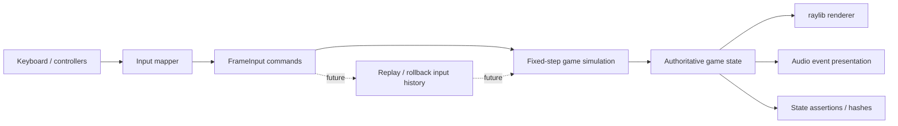
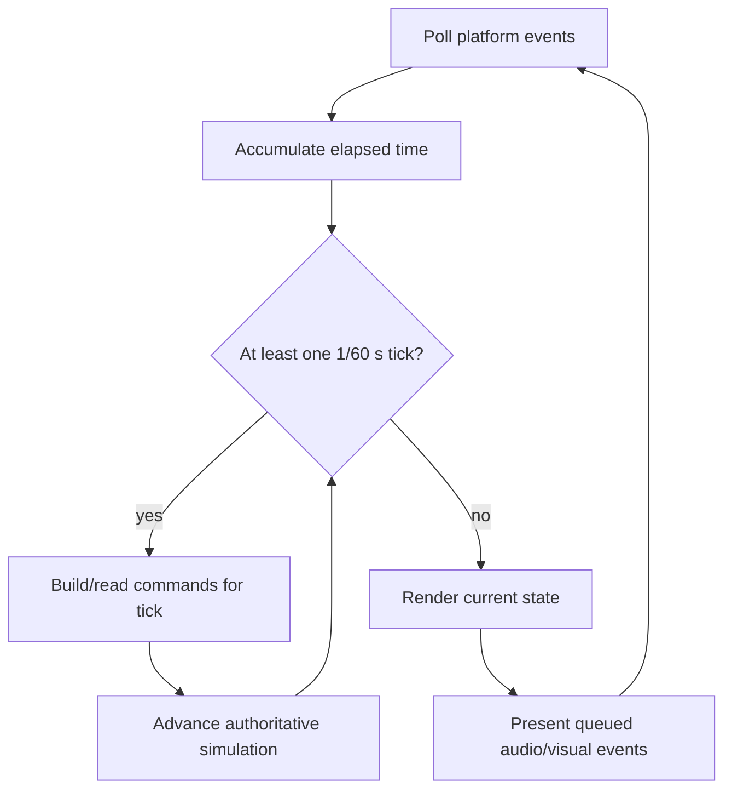
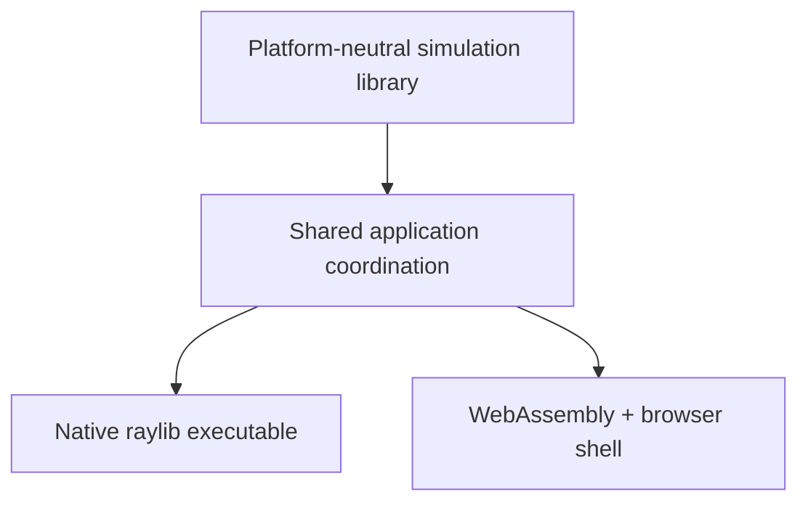

# Architecture

## Status of this document

Unless a section explicitly says **Implemented**, it describes the **proposed** architecture. As of Phase 0, only the repository directories and documentation exist; there is no application, game loop, build configuration, or runtime behavior.

## Design goals

- A readable C++17 codebase with narrow module boundaries
- Fixed 60 Hz gameplay independent of rendering rate
- Testable combat logic with no raylib dependency
- Per-frame input commands suitable for recording and later replay
- A native and WebAssembly application using the same gameplay simulation
- A practical path toward rollback networking without prematurely implementing it

## Proposed source ownership

| Path | Responsibility |
| --- | --- |
| `src/core/` | Application lifecycle, fixed-step timing, shared low-level types |
| `src/game/` | Match orchestration, fighter state, rounds, stage state |
| `src/combat/` | Moves, hit/hurt collision, damage, hit-stun, knockback, combos |
| `src/input/` | Device sampling, bindings, and conversion to frame commands |
| `src/render/` | raylib drawing, cameras, animation presentation, HUD, effects |
| `assets/` | Character, arena, and audio content loaded by presentation systems |
| `tests/` | Unit and integration tests, especially headless simulation tests |
| `scripts/` | Repeatable developer and build-support utilities |

These directories are present. Their runtime contents are not implemented.

## Proposed runtime data flow

The authoritative state changes only during fixed simulation ticks. Rendering and audio may interpolate or present that state but must not modify combat outcomes.

## Application entry point

**Proposed:** A thin platform entry point will configure the application, initialize raylib-facing services, and hand control to the game application. It should contain no fighter or combat rules. Native targets may use a conventional loop; Emscripten may register a browser main-loop callback. Both paths must invoke the same frame and fixed-tick application functions.

## Game loop

**Proposed:** Rendering may run at the platform frame rate, while an accumulator advances zero or more fixed simulation ticks of `1/60` second. Each tick consumes exactly one command per player.

The accumulator will require a maximum catch-up policy so a stalled frame cannot cause an unbounded update loop. The exact policy remains to be selected and tested in Phase 1A.

## Input system

**Proposed:** Platform-specific devices map to a compact `FrameInput`-style value containing directional intent and discrete button states. Gameplay sees commands such as held, pressed, and released actions—not raylib keys. Commands should be serializable and comparable so later systems can record, replay, predict, and correct input histories.

Local bindings will initially support two players on one keyboard. Controller support is planned but not part of the first gameplay milestone.

## Fighter state

**Proposed:** Each fighter owns or references composed state for:

- identity and tuning data;
- position, velocity, facing, and grounded state;
- health and special energy;
- current combat state, move, and frame counters;
- hit-stun, block-stun, invulnerability, and recovery;
- active hitbox/hurtbox data;
- round-local combo and hit tracking.

Simulation state must not contain textures, sounds, or other renderer-owned resources. Fighter definitions should carry data such as movement speeds, move timings, damage, and box definitions separately from mutable match state.

## Combat system

**Proposed:** On each fixed tick, combat processing will follow an explicit, tested order. A likely initial order is command interpretation, state transitions, movement integration, box generation, collision queries, hit resolution, resource changes, and state cleanup. The precise ordering will be documented before combat implementation because it affects trades, interrupts, and replay consistency.

Moves will be described by frame data: startup, active, recovery, damage, hit-stun, block-stun, knockback, energy cost/gain, and box definitions. Combat should emit presentation events rather than directly playing sound or drawing effects.

## Collision detection

**Proposed:** Phase 1 uses simple axis-aligned rectangles in world coordinates for stage collision, hurtboxes, and hitboxes. Collision queries remain in the simulation layer and use gameplay-owned geometry types or adapters independent of raylib. Broad-phase optimization is unnecessary for two fighters until profiling demonstrates a need.

Each attack activation needs a stable identifier so one hitbox does not damage the same target repeatedly unless the move explicitly permits multiple hits.

## Renderer and audio

**Proposed:** The renderer translates read-only game state and presentation events into raylib draw calls. It owns textures, fonts, camera behavior, HUD presentation, animation selection, and effects. The audio presentation layer similarly consumes events and owns sound/music resources.

Placeholder primitives should precede final assets. Art dimensions must not silently define gameplay collision geometry.

## Assets

**Proposed:** Assets are grouped by purpose under `assets/characters/`, `assets/arenas/`, and `assets/audio/`. A later asset manifest may map stable logical identifiers to files. Source/license attribution requirements will be recorded alongside imported content. Generated build copies are ignored; authored source assets remain version-controlled.

## Native and WebAssembly builds

**Proposed:** CMake will define a reusable game/simulation target and a thin application target. Native builds will locate or fetch an explicitly pinned raylib 6.2 according to a dependency policy chosen in Phase 1A. Browser builds will use the Emscripten CMake toolchain and package required assets.

The first build milestone must verify at least one native development environment and one browser build. Linux, Windows, macOS, and browser support must be reported individually and only after testing.

## Future multiplayer integration

**Proposed, not scheduled before Phase 4:** Gameplay commands will be indexed by simulation frame. A rollback layer can later retain recent state snapshots and inputs, predict missing remote commands, then restore and resimulate when confirmed inputs differ. Rendering and audio must tolerate corrected simulation state and avoid duplicating irreversible presentation effects.

Networking will not be embedded in fighter or combat code. Before online play, the project needs deterministic replay tests, state serialization, desync diagnostics, and an explicit session/transport design. Cross-platform bit-for-bit determinism is not assumed.

## Implemented architecture

Phase 0 contains only this documented proposal and the empty source/asset/test/script directory structure. No runtime architecture has yet been validated in code.
