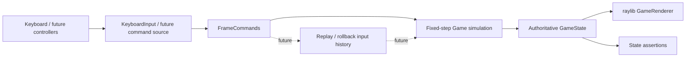
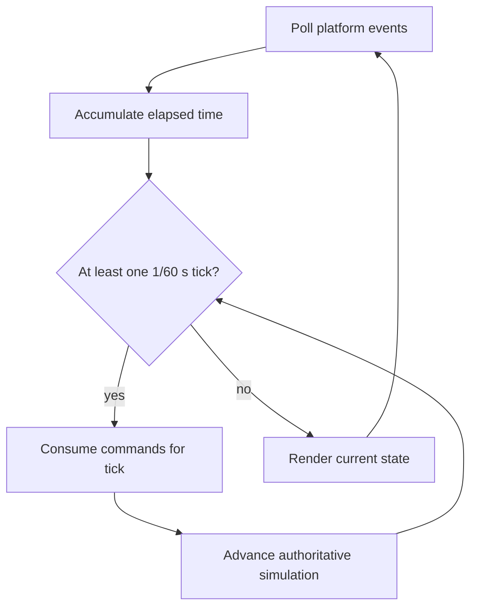
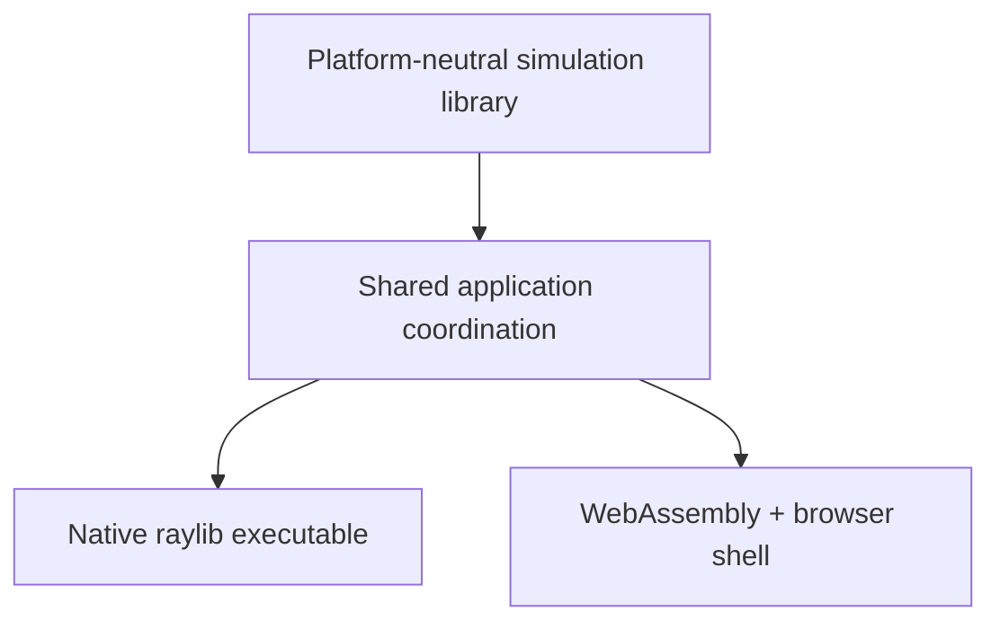

# Architecture

## Status of this document

Sections labeled **Implemented** describe the code through Phase 1E. Movement, combat, energy, character specials, charged attacks, and complete first-to-two local match flow are verified in core tests. The native Linux application and WebAssembly output compile; Chrome runtime verification covers the match flow and charged presentation. The current environment cannot open its X11 display, so this revision's native runtime is unverified. Ultimates, audio, replay storage, and networking remain proposed; Windows and macOS remain untested targets.

## Design goals

- A readable C++17 codebase with narrow module boundaries
- Fixed 60 Hz gameplay independent of rendering rate
- Testable combat logic with no raylib dependency
- Per-frame input commands suitable for recording and later replay
- A native and WebAssembly application using the same gameplay simulation
- A practical path toward rollback networking without prematurely implementing it

## Source ownership

| Path | Responsibility |
| --- | --- |
| `src/core/` | Implemented: platform-neutral game/projectile/match state, fixed-tick round coordination, movement/physics, body collision, charge/release transitions, projectile advancement, and simultaneous combat/energy resolution |
| `src/game/` | Implemented: composed fighter identity, tuning, position, velocity, collision, grounding, facing, health/energy, combat/charge state, move-effect bookkeeping, and feedback state |
| `src/combat/` | Implemented: data-backed normal/special/charged definitions, centralized energy/charge rules and special spending, platform-neutral boxes, overlap queries, and guard queries |
| `src/input/` | Implemented: platform-neutral per-fighter and rematch commands, render-to-tick edge buffering, and raylib keyboard sampling |
| `src/render/` | Implemented: raylib render-target ownership, state-driven arena/fighters/combat effects, projectile presentation, match HUD/results, debug boxes, and scaling |
| `assets/` | Character, arena, and audio content loaded by presentation systems |
| `tests/` | Implemented: raylib-free movement/combat/match timing, projectile lifecycle, KO/draw/scoring/reset/rematch, input, and same-build replay regressions |
| `scripts/` | Implemented: desktop and Emscripten configure/build/run helpers |

`src/main.cpp` owns window lifetime, timing accumulation, input sampling coordination, the presentation-only debug-box toggle, and native/browser loop scheduling. Gameplay decisions remain inside the shared core.

## Runtime data flow — Implemented core path

The authoritative state changes only during fixed simulation ticks. Rendering observes state but cannot modify combat outcomes. A future audio layer should consume presentation events rather than enter the simulation dependency path.

## Application entry point — Implemented

`src/main.cpp` initializes the raylib window and a small application context containing `Game`, `KeyboardInput`, `GameRenderer`, the timing accumulator, and debug-draw state. Native builds use a conventional loop. Emscripten builds register `BrowserMainLoop` with `emscripten_set_main_loop_arg`, so browser code does not enter a blocking loop. The browser callback does not call raylib's synchronous `WindowShouldClose()` or target-FPS wait paths; requestAnimationFrame owns scheduling. Both platforms call the same `RunFrame` function.

## Game loop — Implemented

Rendering runs at the platform frame rate while an accumulator advances zero or more fixed simulation ticks of `1/60` second. Frame delta is clamped to 250 ms, bounding a single rendered frame to at most 15 catch-up ticks. Input is sampled once per rendered frame. `FrameCommandBuffer` keeps the latest held values available to every catch-up tick, OR-accumulates press/release edges across render frames with no tick, and clears those edges after exactly one simulation-tick consumption.

The browser loop and combat rendering are verified in automated Chrome testing. The native loop, combat rendering, and normal Escape shutdown are verified in a Linux X11/OpenGL session.

## Input system — Implemented

`FrameCommands` contains one `FighterCommand` per player plus a match-level `restartPressed` edge. Each fighter command records held movement/jump/block/attack values, just-pressed jump/light/heavy events, and held/pressed/released special and charged-attack values. `KeyboardInput` is the only gameplay-input component that queries raylib: it maps VOLT to `A`/`D`/`W`/`S`/`F`/`G`/`H`/`J`, EMBER to Left/Right/Up/Down/`K`/`L`/semicolon/apostrophe, and rematch to `R` or Enter, then passes plain sampled values to `FrameCommandBuffer`.

Normal attack held values document current device state but do not start moves; only a new buffered press can do so. Charge starts from a press, advances from held state, and resolves once from a release edge or observed not-held state into cancellation or a configured charged move. A buffered special press selects the fighter's configured special and attempts an atomic activation/spend. Restart is consumed only in `MatchOver`. Because the buffer consumes every one-shot edge on one simulation tick even when combat is disabled, round-over and intro inputs cannot leak into a later fighting phase. `Game` never queries devices, so tests and future replay, AI, or network sources can provide the same commands directly.

raylib 6.2's Emscripten backend maps physical DOM `Semicolon` and `Quote` codes to `KEY_SEMICOLON` and `KEY_APOSTROPHE` and registers key-down/key-up callbacks on the canvas. Chrome runtime input verified both special controls, including the `Semicolon` DOM code; physical keyboard ghosting, rollover, and non-US punctuation layouts remain device-dependent and unverified.

## Fighter state — Implemented

Each `Fighter` composes:

- identity, movement speed, jump velocity, and collision dimensions;
- platform-neutral position and velocity values;
- grounded state and facing direction;
- mutable current/maximum health and energy;
- available, attacking, blocking, charging, hit-stun, or KO state;
- current move/phase and frame count, stun duration, per-activation connection/effect flags, charge duration/release outcome, and short hit/block/special-impact feedback counters.

`GameState` also owns a fixed eight-slot array of projectile values. An active projectile stores its owner, source move, position/velocity, captured direction, remaining lifetime, and current hitbox. Charged move selection is represented by stable move identifiers and existing copyable fighter fields; no separate charge-combat object or heap ownership is introduced. Simulation state contains no textures, sounds, raylib vectors, heap-owned projectile entities, or other presentation resources. Ultimates and combos are not implemented.

## Match state — Implemented in Phase 1E

`GameState` stores a value-based `MatchPhase` (`RoundIntro`, `Fighting`, `RoundOver`, or `MatchOver`), round result/end reason, match winner, two round-win counters, round number, authoritative timer ticks, and phase-transition ticks. `MatchRules` supplies production defaults of 5,400 fighting ticks, 180 intro ticks, and 180 round-over ticks; tests may construct `Game` with shorter values without changing production balance.

Only `Fighting` runs movement/combat and decrements the timer. After the contact snapshot is fully applied, KO is resolved before timeout, making a final-tick KO independent of timer ordering. `FinishRound` changes phase and awards at most one score; all later round-over ticks bypass combat. At transition, one reset function recreates both fighters from their canonical definitions, clears the fixed projectile pool and transient state, restores the timer, and preserves scores. A second win transitions from `RoundOver` to `MatchOver`; an accepted restart rebuilds a clean match while preserving the monotonically advancing global simulation frame.

## Combat system — Implemented through Phase 1D-C

`MoveDefinition` stores a stable move identifier, owning fighter, melee/projectile behavior, energy cost, damage, startup/active/recovery frame counts, hitbox dimensions/offsets, hit-stun, knockback, projectile speed, and projectile lifetime. Shared definitions provide light (6 damage, 5/3/10 frames), heavy (14 damage, 12/4/17), VOLT's Thunder Bolt (16 damage, 12/1/20, 650 units/second, 90-tick lifetime), EMBER's Inferno Burst (20 damage, 16/5/24), and six charged fighter/level variants. `CombatRules` centralizes the 100 energy cap, normal hit/block awards, 25 special cost, and 18/36/60/72 charge thresholds. Block-stun and multi-hit data remain absent.

The press tick is startup frame 1. A phase is processed for exactly its configured number of ticks; the next phase begins at the start of the following tick. After the last recovery tick, the fighter becomes available at the start of the next tick and may accept a command then. A new hit sets hit-stun frame progress to zero after impact, so the configured number of restricted stun ticks begins on the following tick.

The implemented per-tick order is:

1. Decay feedback; complete elapsed attack/stun phases; validate block, normal, special, and charge transitions, including atomic special spending.
2. Apply permitted movement input, integrate horizontal movement and gravity, and constrain the stage.
3. Resolve symmetric movement-body collision using prior left/right order.
4. Update facing from final positions.
5. Advance existing projectiles, then create a projectile once for each newly active projectile move.
6. Generate melee hitboxes and snapshot both fighter and projectile overlaps, guard outcomes, origins, and move references without damage mutation.
7. Mark every valid melee activation as connected or projectile as inactive, then advance existing attack/stun frame counters.
8. Resolve the snapshotted energy awards, blocks or damage, charge/special interruption, hit-stun, knockback, health clamp, and KO outcomes.
9. Decrement projectile lifetime/remove expired or out-of-bounds projectiles.
10. Decrement the fighting timer, then resolve KO before timeout and enter `RoundOver` at most once; finally increment the simulation frame.

Because step 6 snapshots all candidates before step 8 changes either fighter, simultaneous valid normal, burst, and projectile contacts resolve without player-one/player-two validation bias. This permits trades and double KO even when one outcome interrupts a source. One-hit bookkeeping is also committed for all candidates before outcome mutation, avoiding repeated active-frame results.

Grounded held block is valid only in the blocking state and only when the contact origin is on the side the defender faces. It prevents all current normal, special, and charged damage and has no block-stun or chip damage. Attack recovery, charging, hit-stun, and KO reject new attacks. Command priority is block, light, heavy, special, then charge. Charging is grounded, stops movement, rejects jump/block/new attacks, counts its accepted press tick as frame 1, caps at 72, and cancels below 18 on release. A valid release selects level 1 at 18–35, level 2 at 36–59, or level 3 at 60–72, clears the accumulated duration, and enters normal attack startup. An unblocked hit interrupts charging or any attack phase; spent special energy is not refunded, and an already-created projectile persists independently.

Energy awards are part of each snapshotted normal-hit outcome. A light/heavy hit adds 8/12 to the attacker; a blocked normal adds 4 to the attacker and 6 to the defender. Because the activation is marked connected before outcomes apply, neither damage nor energy repeats on later active frames. Awards clamp to 100. Special activation requires `Available` state and at least 25 energy, and deducts exactly 25 when startup begins. Special and charged hits/blocks deliberately grant no energy; charged activation also costs none.

## Collision detection — Implemented movement and combat boxes

Movement uses simple axis-aligned body rectangles in world coordinates. Each body is 64 units wide × 112 units tall, anchored at the fighter's bottom-center position. Fighter centers are constrained so the entire body remains between stage edges x=80 and x=1200, and the ground plane is y=564.

After both fighters integrate movement, overlapping body boxes are separated horizontally according to their prior left/right order. Each receives half the correction; if a stage wall prevents one half, the unresolved amount moves the other fighter. Horizontal velocity toward the collision is cleared. Vertically separated boxes do not collide, allowing airborne cross-over before facing is recalculated.

Hurtboxes currently reuse the body rectangle. Active melee hitboxes are built from move-owned width, height, forward offset, and bottom offset, mirrored from the bottom-center fighter anchor according to facing. Projectiles carry their own world-space rectangle and velocity. Strict positive-area overlap is required, so horizontal range and vertical separation both matter. Combat geometry contains no raylib types.

Each melee activation tracks whether it already connected. A hit or blocked contact consumes that activation, preventing repeated outcomes on consecutive active frames. Projectile contact deactivates that projectile immediately after snapshot collection. With two fighters, every query targets the explicit opponent index, so a move never tests against its owner. Thunder Bolt captures its direction on creation, uses the projectile position as its impact origin, and does not follow its owner. Broad-phase optimization is unnecessary at this scale.

## Renderer and audio

**Renderer implemented:** `GameRenderer` translates read-only `GameState` into raylib draw calls, owns a 1280×720 render texture, and owns one neutral `Texture2D` for each fighter. Sprite definitions currently contain only a texture-space ground pivot and uniform scale. Body selection is fighter-driven, leaving a small seam where later state/clip selection can replace `neutral.png` without entering simulation code. Textures load once after graphics initialization and valid GPU handles unload with the renderer.

Rendering is layered as arena, fighter backdrop effects, large special fields, fighter bodies, fighter feedback, projectiles, optional `F1` boxes, and HUD. This prevents the static sprite replacement from hiding charge, guard, hit/impact, projectile, KO, or debug presentation. If a texture is missing or invalid, only that fighter body returns to the prior procedural renderer. Core state contains no raylib types, and rendering does not mutate it.

**Audio proposed:** No audio resources or presentation layer exist yet. A later audio layer should consume events and own sound/music resources without changing simulation outcomes.

The Phase 2A bodies are static neutral sprites, not animation. Art dimensions do not define gameplay collision geometry; the 64×112 simulation body and all combat boxes remain unchanged.

## Assets

**Partially implemented:** Authored RGBA PNGs live at `assets/characters/<fighter>/neutral.png`. VOLT uses texture pivot `(708, 1209)` at scale `0.27`; EMBER uses `(704, 1221)` at scale `0.26`. These values were calibrated from each illustration's opaque stance and put both planted-foot anchors on the fighter's world position with similar visible heights. Horizontal mirroring also mirrors the pivot coordinate, so changing facing does not translate the feet. A later lightweight manifest or clip definition may extend this metadata for animation. Arena/audio asset loading and explicit source/license metadata remain future work.

## Native and WebAssembly builds — Implemented and verified on Linux

CMake defines `arena_clash_core`, `ArenaClash`, and `arena_clash_core_tests`. FetchContent downloads the official raylib 6.2 tag archive and verifies its SHA-256. `ARENA_CLASH_BUILD_APPLICATION=OFF` permits headless core tests without configuring raylib.

Native builds use `build/desktop` and copy the character directory beside `ArenaClash`; the renderer also checks its application directory when the process working directory differs. Browser builds use the Emscripten toolchain in `build/web`, set raylib's `PLATFORM` to `Web`, emit `arena-clash.html`, use `web/shell.html`, and preload `assets/characters/` into the virtual filesystem at the same runtime path. Keeping these directories separate prevents incompatible toolchain caches and raylib artifacts from being shared.

The Phase 1E core, CTest executable, and native raylib application build on Linux, and both Linux CTest trees pass. The current native runtime launch cannot open X11 display `:0`, so current native visuals and controls are not verified. Emscripten 6.0.12 output builds and completes an automated Chrome 153 two-round match/rematch flow with WebGL error state 0. Windows and macOS remain untested targets.

## Future multiplayer integration

**Proposed, not scheduled before Phase 4:** Gameplay commands will be indexed by simulation frame. A rollback layer can later retain recent state snapshots and inputs, predict missing remote commands, then restore and resimulate when confirmed inputs differ. Rendering and audio must tolerate corrected simulation state and avoid duplicating irreversible presentation effects.

Networking will not be embedded in fighter or combat code. Before online play, the project needs deterministic replay tests, state serialization, desync diagnostics, and an explicit session/transport design. Cross-platform bit-for-bit determinism is not assumed.

## Implemented architecture

Phases 1A through 1E establish these validated boundaries:

- `arena_clash_core` contains only standard C++ state, frame commands/buffering, match flow, movement/body collision, combat geometry, energy rules, charge transitions, projectile simulation, and combat resolution.
- `KeyboardInput` owns raylib key mapping; `FrameCommandBuffer` owns platform-neutral held/edge lifetime across render and simulation rates.
- `GameRenderer` owns raylib resources and observes `const GameState&`.
- `main.cpp` owns platform lifecycle, wall-clock accumulation, and loop registration.
- Native and browser paths share `RunFrame`, `Game`, and rendering code; only scheduling differs.
- Generated dependencies and outputs live under target-specific ignored build directories.
- Initial and inter-round state use shared fighter initialization; `Game::initialize` creates a clean match, while general serialization/restoration remains deferred.
- Replaying the same tested commands produces identical fighter, projectile, timer, scoring, phase, match-winner, and rematch state after every tick in the verified Linux build.

Ultimates, audio, replay storage, deterministic state hashing, and rollback remain proposed. Fixed ticks and repeatable same-build tests are preparation for those systems, not evidence of cross-platform determinism.
