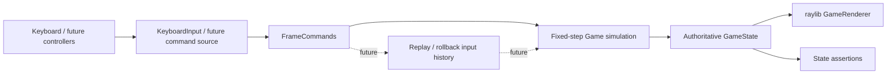
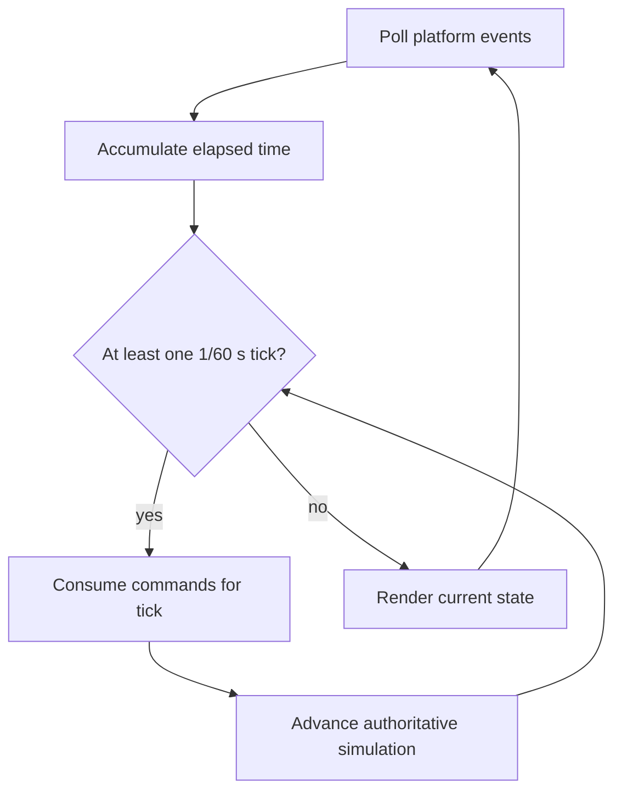
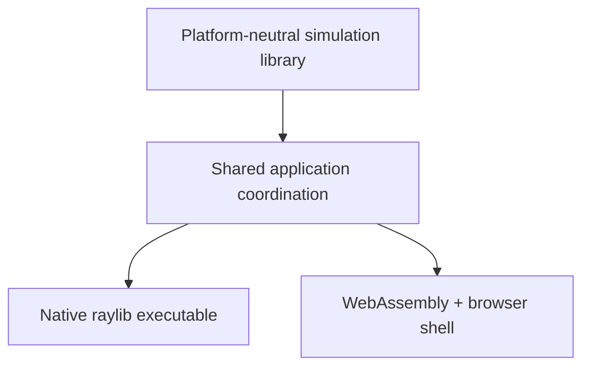

# Architecture

## Status of this document

Sections labeled **Implemented** describe the code through Phase 1C. Movement and basic combat are verified in core tests plus native Linux and Chrome/WebAssembly runtime checks. Audio, replay storage, round flow, and networking remain proposed; Windows and macOS remain untested targets.

## Design goals

- A readable C++17 codebase with narrow module boundaries
- Fixed 60 Hz gameplay independent of rendering rate
- Testable combat logic with no raylib dependency
- Per-frame input commands suitable for recording and later replay
- A native and WebAssembly application using the same gameplay simulation
- A practical path toward rollback networking without prematurely implementing it

## Source ownership

| Path | Responsibility |
| --- | --- |
| `src/core/` | Implemented: platform-neutral game state, fixed-tick coordination, movement/physics, body collision, state transitions, and simultaneous combat resolution |
| `src/game/` | Implemented: composed fighter identity, tuning, position, velocity, collision, grounding, facing, health, combat state, timers, and feedback state; future match/round state belongs here |
| `src/combat/` | Implemented: data-backed light/heavy definitions, platform-neutral rectangles, hitbox/hurtbox construction, overlap queries, and directional guard queries |
| `src/input/` | Implemented: platform-neutral per-fighter commands plus raylib keyboard sampling, buffered one-shot presses, held states, and tick consumption |
| `src/render/` | Implemented: raylib render-target ownership, state-driven arena/fighters/combat poses/effects, live health HUD, KO feedback, debug boxes, and scaling |
| `assets/` | Character, arena, and audio content loaded by presentation systems |
| `tests/` | Implemented: raylib-free movement, combat timing, hit/block/miss/trade/KO, boundary, input, and same-build replay regressions |
| `scripts/` | Implemented: desktop and Emscripten configure/build/run helpers |

`src/main.cpp` owns window lifetime, timing accumulation, input sampling coordination, the presentation-only debug-box toggle, and native/browser loop scheduling. Gameplay decisions remain inside the shared core.

## Runtime data flow — Implemented core path

The authoritative state changes only during fixed simulation ticks. Rendering observes state but cannot modify combat outcomes. A future audio layer should consume presentation events rather than enter the simulation dependency path.

## Application entry point — Implemented

`src/main.cpp` initializes the raylib window and a small application context containing `Game`, `KeyboardInput`, `GameRenderer`, the timing accumulator, and debug-draw state. Native builds use a conventional loop. Emscripten builds register `BrowserMainLoop` with `emscripten_set_main_loop_arg`, so browser code does not enter a blocking loop. The browser callback does not call raylib's synchronous `WindowShouldClose()` or target-FPS wait paths; requestAnimationFrame owns scheduling. Both platforms call the same `RunFrame` function.

## Game loop — Implemented

Rendering runs at the platform frame rate while an accumulator advances zero or more fixed simulation ticks of `1/60` second. Frame delta is clamped to 250 ms, bounding a single rendered frame to at most 15 catch-up ticks. Input is sampled once per rendered frame. Held values remain available to every catch-up tick, while pending jump/light/heavy presses are consumed by only the first tick and stay buffered if no simulation tick is due yet.

The browser loop and combat rendering are verified in automated Chrome testing. The native loop, combat rendering, and normal Escape shutdown are verified in a Linux X11/OpenGL session.

## Input system — Implemented

`FrameCommands` contains one `FighterCommand` per player. Each command records held movement/jump/block/attack values and just-pressed jump/light/heavy events. `KeyboardInput` is the only gameplay-input component that queries raylib: it maps VOLT to `A`/`D`/`W`/`S`/`F`/`G` and EMBER to Left/Right/Up/Down/`K`/`L`, buffers one-shot edges until a simulation tick consumes them, and returns a plain C++ value.

Attack held values document current device state but do not start moves; only a new buffered press can do so. `Game` never queries devices, so tests and future replay, AI, or network sources can provide the same commands directly. Controller support and rebinding remain future work.

## Fighter state — Implemented

Each `Fighter` composes:

- identity, movement speed, jump velocity, and collision dimensions;
- platform-neutral position and velocity values;
- grounded state and facing direction;
- mutable current/maximum health;
- available, attacking, blocking, hit-stun, or KO state;
- current move/phase and frame count, stun duration, per-activation connection flag, and short hit/block feedback counters.

Simulation state contains no textures, sounds, raylib vectors, or other presentation resources. Special energy, projectiles, charged moves, combos, and match/round state are not implemented.

## Combat system — Implemented Phase 1C subset

`MoveDefinition` stores a stable move identifier, damage, startup/active/recovery frame counts, hitbox dimensions/offsets, hit-stun duration, and horizontal knockback. Shared definitions currently provide light (6 damage, 5/3/10 frames) and heavy (14 damage, 12/4/17 frames). Future energy, block-stun, multi-hit, projectile, charge, and cancel data is intentionally absent until its owning phase.

The press tick is startup frame 1. A phase is processed for exactly its configured number of ticks; the next phase begins at the start of the following tick. After the last recovery tick, the fighter becomes available at the start of the next tick and may accept a command then. A new hit sets hit-stun frame progress to zero after impact, so the configured number of restricted stun ticks begins on the following tick.

The implemented per-tick order is:

1. Decay feedback; complete elapsed attack/stun phases; validate block and attack transitions.
2. Apply permitted movement input, integrate horizontal movement and gravity, and constrain the stage.
3. Resolve symmetric movement-body collision using prior left/right order.
4. Update facing from final positions.
5. Generate active hitboxes and snapshot both fighters' valid overlaps, guard outcomes, and move references without damage mutation.
6. Mark every valid attack activation as connected, then advance existing attack/stun frame counters.
7. Resolve the snapshotted blocks or damage, hit-stun, knockback, health clamp, and KO outcomes.
8. Increment the simulation frame.

Because step 5 snapshots both candidates before step 7 changes either fighter, two simultaneously active and overlapping attacks both resolve. This permits trades and double KO without player-one/player-two validation bias. One-hit bookkeeping is also marked for both candidates before outcome mutation, avoiding order-dependent transient state.

Grounded held block is valid only in the blocking state and only when the attacker is on the side the defender faces. Block takes priority over attack on the same tick, prevents all current light/heavy damage, and has no block-stun or chip damage in Phase 1C. Attack recovery, hit-stun, and KO reject new attacks. Grounded attacks/blocks stop horizontal movement, airborne attacks retain existing momentum, and hit-stun/KO knockback is damped while stage constraints remain authoritative.

## Collision detection — Implemented movement and combat boxes

Movement uses simple axis-aligned body rectangles in world coordinates. Each body is 64 units wide × 112 units tall, anchored at the fighter's bottom-center position. Fighter centers are constrained so the entire body remains between stage edges x=80 and x=1200, and the ground plane is y=564.

After both fighters integrate movement, overlapping body boxes are separated horizontally according to their prior left/right order. Each receives half the correction; if a stage wall prevents one half, the unresolved amount moves the other fighter. Horizontal velocity toward the collision is cleared. Vertically separated boxes do not collide, allowing airborne cross-over before facing is recalculated.

Hurtboxes currently reuse the body rectangle. Active hitboxes are built from move-owned width, height, forward offset, and bottom offset, mirrored from the bottom-center fighter anchor according to facing. Strict positive-area overlap is required, so horizontal range and vertical separation both matter. Combat geometry contains no raylib types.

Each attack activation tracks whether it already connected. A hit or blocked contact consumes that activation, preventing repeated outcomes on consecutive active frames. With two fighters, each hit query targets the explicit opponent index, so an attack never tests against its owner. Broad-phase optimization is unnecessary at this scale.

## Renderer and audio

**Renderer implemented:** `GameRenderer` translates read-only `GameState` into raylib draw calls and owns a 1280×720 render texture. It draws the arena, state-specific attack/guard poses, hit and block cues, live numeric health bars, KO labels, the controls overlay, and optional `F1` hurtbox/active-hitbox outlines, then scales and letterboxes the result. Core state contains no raylib types, and rendering does not mutate it.

**Audio proposed:** No audio resources or presentation layer exist yet. A later audio layer should consume events and own sound/music resources without changing simulation outcomes.

Placeholder primitives precede final assets. Art dimensions do not define gameplay collision geometry.

## Assets

**Proposed:** Assets are grouped by purpose under `assets/characters/`, `assets/arenas/`, and `assets/audio/`. A later manifest may map stable logical identifiers to files. Source/license attribution requirements will be recorded alongside imported content. Generated build copies are ignored; authored source assets remain version-controlled.

## Native and WebAssembly builds — Implemented and verified on Linux

CMake defines `arena_clash_core`, `ArenaClash`, and `arena_clash_core_tests`. FetchContent downloads the official raylib 6.2 tag archive and verifies its SHA-256. `ARENA_CLASH_BUILD_APPLICATION=OFF` permits headless core tests without configuring raylib.

Native builds use `build/desktop`. Browser builds use the Emscripten toolchain in `build/web`, set raylib's `PLATFORM` to `Web`, emit `arena-clash.html`, and use `web/shell.html`. Keeping these directories separate prevents incompatible toolchain caches and raylib artifacts from being shared.

The core target and CTest executable have been built on Linux. Emscripten 6.0.12 output is verified in headless Google Chrome 153 with active WebGL and exercised combat input. The native Linux Release target is verified using raylib's X11 backend and an Intel/Mesa OpenGL 4.6 context, including a simultaneous combat trade and clean Escape shutdown. Windows and macOS remain untested targets.

## Future multiplayer integration

**Proposed, not scheduled before Phase 4:** Gameplay commands will be indexed by simulation frame. A rollback layer can later retain recent state snapshots and inputs, predict missing remote commands, then restore and resimulate when confirmed inputs differ. Rendering and audio must tolerate corrected simulation state and avoid duplicating irreversible presentation effects.

Networking will not be embedded in fighter or combat code. Before online play, the project needs deterministic replay tests, state serialization, desync diagnostics, and an explicit session/transport design. Cross-platform bit-for-bit determinism is not assumed.

## Implemented architecture

Phases 1A through 1C establish these validated boundaries:

- `arena_clash_core` contains only standard C++ state, frame commands, movement/body collision, combat geometry, and combat resolution.
- `KeyboardInput` owns raylib key mapping; buffered one-shot presses survive render frames with no simulation tick and are consumed once during multi-tick catch-up.
- `GameRenderer` owns raylib resources and observes `const GameState&`.
- `main.cpp` owns platform lifecycle, wall-clock accumulation, and loop registration.
- Native and browser paths share `RunFrame`, `Game`, and rendering code; only scheduling differs.
- Generated dependencies and outputs live under target-specific ignored build directories.
- The initial core state can be recreated with `Game::initialize`; general serialization/restoration is deferred.
- Replaying the same tested movement/combat command sequence produces the same complete fighter state after every tick in the verified Linux build.

Special/charged combat, match flow, audio, replay storage, deterministic state hashing, and rollback remain proposed. Fixed ticks and repeatable same-build tests are preparation for those systems, not evidence of cross-platform determinism.
